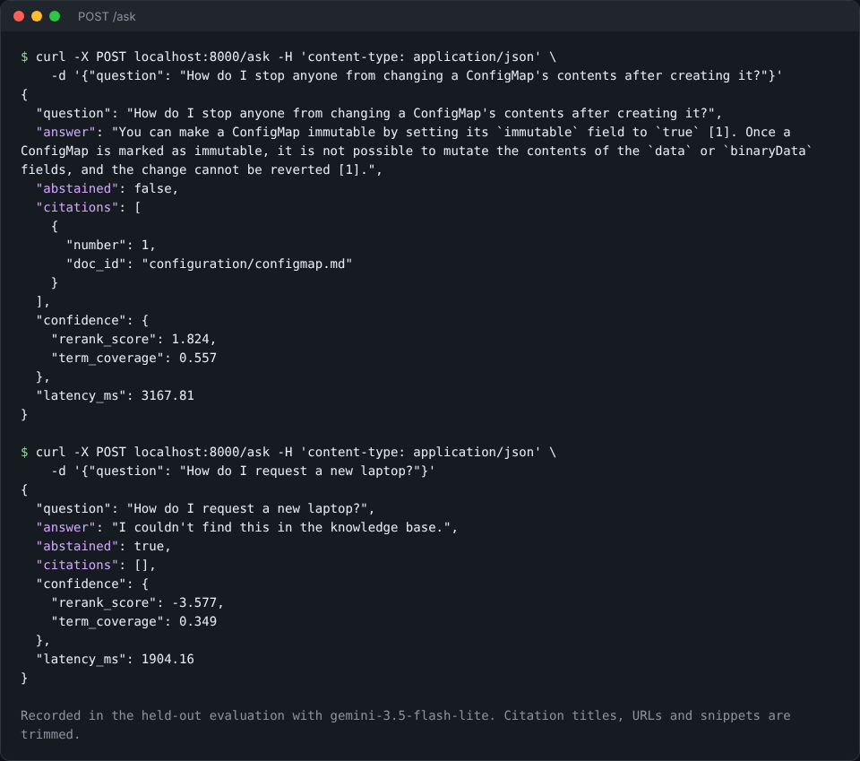
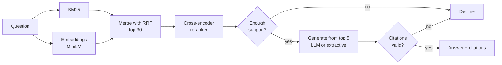

# Enterprise AI Knowledge Assistant

[](https://github.com/ykrubha/enterprise-rag-assistant/actions/workflows/tests.yml)

A retrieval-augmented generation (RAG) service that answers questions from a document collection, cites its sources, and declines when the documents don't support an answer. It has a FastAPI backend, hybrid search with reranking, and an evaluation pipeline with a held-out test set.

The knowledge base here is the Kubernetes concept documentation (186 documents, 2,902 chunks), standing in for an internal engineering wiki.



*Two responses recorded in the held-out evaluation with `gemini-3.5-flash-lite`: one answered with a citation, one declined because the documents don't cover it.*

## How it works



Design choices:

- **Hybrid search.** BM25 finds exact terms such as `allowVolumeExpansion`, while embeddings find meaning when the wording differs. Reciprocal rank fusion merges them, then a cross-encoder reranks the top 30.
- **Declining is a feature.** A threshold on the reranker's score stops unsupported questions before they reach the generator. It's tuned only on development questions.
- **Citations are enforced in code.** An answer is only shown if it cites at least one source and every number maps to a retrieved chunk. Citations are renumbered in order of use.
- **Heading-aware chunking.** Each chunk keeps its title and section path, so a passage doesn't lose its context.
- **Access filtering before ranking.** A request can restrict search to specific collections, and the filter applies before ranking, so a chunk outside them can't be retrieved.
- **Two generators.** An LLM writes grounded answers through Claude or any OpenAI-compatible API. An offline extractive mode quotes source sentences and needs no API key.

## Results

Scored on a held-out set of 40 answerable and 12 unanswerable questions, on topics separate from the development questions. The test set was written after the system was frozen.

### Retrieval

| Method | Hit@1 | Hit@3 | Hit@5 | MRR@10 (95% CI) | nDCG@10 | Key fact in top 5 |
|---|---:|---:|---:|---:|---:|---:|
| BM25 | 0.42 | 0.62 | 0.72 | 0.54 (0.41-0.67) | 0.59 | 0.80 |
| Embeddings | 0.57 | 0.72 | 0.82 | 0.67 (0.54-0.79) | 0.70 | 0.78 |
| Hybrid (RRF) | 0.70 | 0.80 | 0.88 | 0.77 (0.65-0.87) | 0.78 | 0.78 |
| **Hybrid + reranker** | 0.55 | 0.85 | **0.90** | 0.70 (0.59-0.81) | 0.74 | **0.85** |

Hit@k is the share of questions with a correct document in the top k results. "Key fact in top 5" checks that the text containing the answer was actually retrieved.

- **Hybrid beat either method alone** on every metric here except key fact retrieval, where BM25 was highest of the three.
- **The reranker is a mixed result.** It improved Hit@3, Hit@5 and key fact retrieval, which matter most when an LLM reads the top 5. It lowered Hit@1 and MRR compared with plain hybrid. The confidence intervals overlap, so 40 questions can't settle this.

### Answers with an LLM

Using `gemini-3.5-flash-lite` on top of the retrieval above:

| Metric | Score |
|---|---:|
| Answerable questions answered | 35 of 40 (0.88) |
| Key fact present, all answerable questions | 30 of 40 (0.75) |
| Key fact present, when it answered | 30 of 35 (0.86) |
| Answers citing a correct document | 0.91 |
| Citation precision | 0.80 |
| Unanswerable questions correctly declined | 12 of 12 (1.00) |
| Declines that were correct | 12 of 17 (0.71) |
| Latency p50 / p95 | 3.9 s / 41.4 s |

- **It didn't answer any unanswerable question.** The search threshold stopped 9 of the 12, and the LLM declined the other 3.
- **It's cautious.** It wrongly declined 5 answerable questions: 3 where the LLM said the sources didn't cover it, 1 stopped by the search threshold, and 1 answer rejected for having no citation. Declining is safer than guessing here, but it does cost coverage.
- **The p95 latency isn't a clean measure.** The run used a free-tier API with pacing and automatic retries on a laptop, so it can't show normal production latency.

**This was the second run on the test set, and that matters.** The first run answered 0.60 of answerable questions, with key fact recall of 0.53 and the same 12 of 12 declines. Investigating showed that the code rejected citations written as `[1, 2]`, and that the LLM was too cautious about everyday wording. The citation parser and prompt were fixed and checked on the development questions, then the test set was run once more. Nothing was tuned on individual test questions, but the test set had been seen by then, so these scores may be somewhat optimistic.

### Answers: offline extractive baseline

| Metric | Score |
|---|---:|
| Answerable questions answered | 39 of 40 (0.97) |
| Key fact present, all answerable questions | 24 of 40 (0.60) |
| Answers citing a correct document | 0.72 |
| Citation precision | 0.48 |
| Unanswerable questions correctly declined | 9 of 12 (0.75) |
| Declines that were correct | 9 of 10 (0.90) |
| Latency p50 / p95, 2-core CPU | 4.4 s / 6.6 s |

This mode needs no API key. It only picks sentences, so it can't combine or rephrase them, and it has no way to refuse once a question passes the search threshold. The LLM improved key fact recall from 0.60 to 0.75, and declines on unanswerable questions from 9 to 12.

## How to read these scores

- **The questions are hand-written.** They phrase things in everyday language on purpose, such as "machine" for node. Key facts are checked with patterns, which is a rough measure: a correct answer in different words can be missed, and a mention isn't proof that an answer is right.
- **The sample is small.** With 40 answerable and 12 unanswerable questions, small differences aren't meaningful, and 12 of 12 doesn't mean it will always decline correctly.
- **One LLM, one run.** LLM replies can vary between runs, and a different model would score differently.
- **Corpus scale.** 186 well-written public documents are far cleaner than a real company wiki. There's no duplicate or outdated content here, and this isn't a load test.
- **An earlier version was weaker.** The first design used a lightweight static embedding model and scored 0.72 Hit@5. Studying those failures led to the current design, so those questions became development data, and this test set is new.
- **Search is CPU-bound.** The reranker takes several seconds on 2 cores. A GPU, fewer candidates, or a smaller reranker would reduce that.

## Quick start

```bash
python -m venv .venv && source .venv/bin/activate
pip install -e ".[dev]"
pytest -q                            # uses fake models, so no downloads needed

python scripts/download_models.py    # about 100 MB
python scripts/build_index.py        # downloads the docs and builds the index, 2 to 3 minutes
python -m eval.run_eval --split test # reproduce the retrieval and extractive tables, about 15 minutes
```

Score an LLM on the same test set, using any OpenAI-compatible API or Claude:

```bash
export OPENAI_BASE_URL=https://generativelanguage.googleapis.com/v1beta/openai/
export OPENAI_API_KEY=...
python -m eval.run_eval --split test --generator openai --model gemini-3.5-flash-lite --min-seconds-between-calls 5 --no-retrieval
```

Run the service:

```bash
uvicorn kb_assistant.api:app --port 8000
```

Use an LLM by setting `KB_LLM_PROVIDER` to `anthropic` or `openai`, along with `KB_LLM_MODEL` and that provider's API key. Set `KB_API_KEY` to require an `x-api-key` header.

```bash
curl -X POST localhost:8000/ask -H 'content-type: application/json' \
  -d '{"question": "How do I request a new laptop?"}'
```

```json
{
  "question": "How do I request a new laptop?",
  "answer": "I couldn't find this in the knowledge base.",
  "abstained": true,
  "citations": [],
  "confidence": {"rerank_score": -3.577, "term_coverage": 0.349},
  "latency_ms": 3871.69
}
```

| Endpoint | Purpose |
|---|---|
| `POST /ask` | Answer a question with citations, or decline |
| `POST /search` | Return ranked chunks, using `rerank`, `hybrid`, `bm25` or `dense` |
| `GET /categories` | List collections to filter by |
| `GET /health` | Report service status and index size |

## Project layout

```
src/kb_assistant/
  ingest.py      Markdown cleaning and heading-aware chunking
  index.py       BM25, embeddings, RRF, reranking, filters
  assistant.py   decline policy, generators, citation checks
  api.py         FastAPI service
eval/
  questions.py        development questions
  test_questions.py   held-out test questions
  run_eval.py         retrieval and answer metrics
scripts/         download models, build the index
results/         every number in this README, as JSON with per-question detail
tests/           ingestion, search, citations, LLM adapters, API
```

## Data and licenses

- **Code:** MIT.
- **Documents:** [Kubernetes documentation](https://github.com/kubernetes/website), CC BY 4.0. They're downloaded at a pinned commit and not included in this repository.
- **Models:** `all-MiniLM-L6-v2` and `ms-marco-MiniLM-L-6-v2` from sentence-transformers, Apache-2.0. These are ONNX exports by Xenova, downloaded through a third-party npm package (`kontexta-reranker-model`) because Hugging Face wasn't reachable where this was built. Files are checked against pinned SHA-256 hashes, and the embedding model's hash also matched a copy from a second, unrelated npm publisher. The reranker has no such second check, so use the official Hugging Face release in production.
